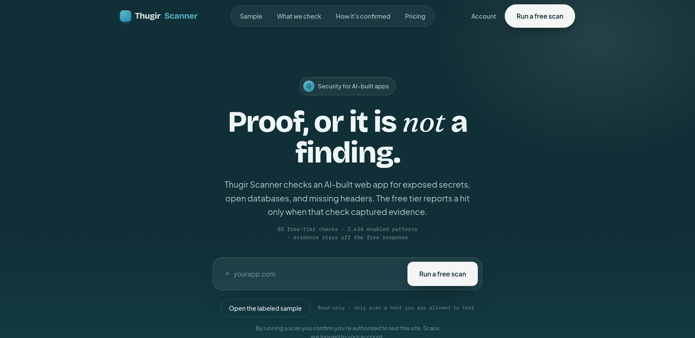
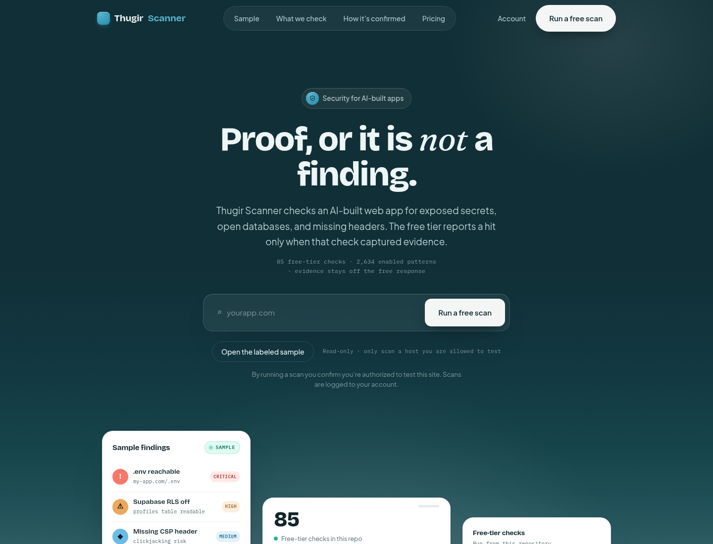
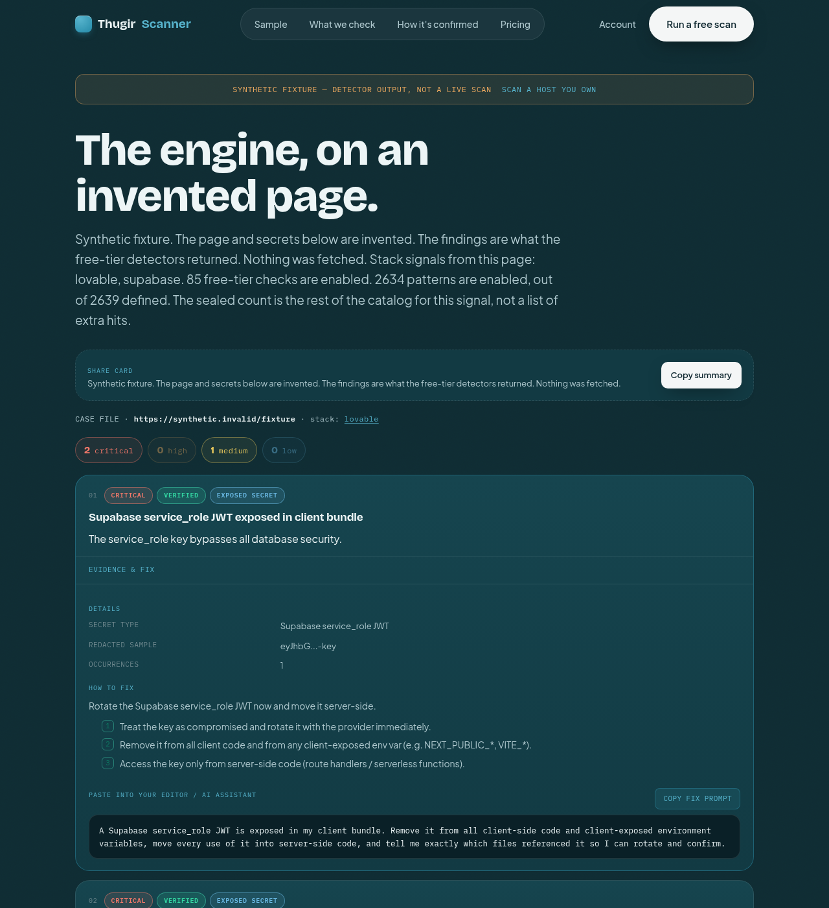
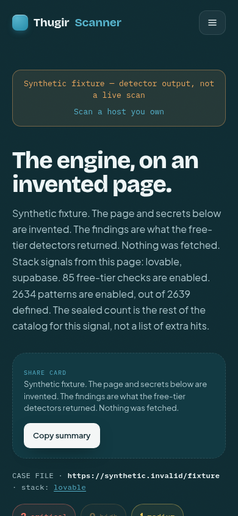
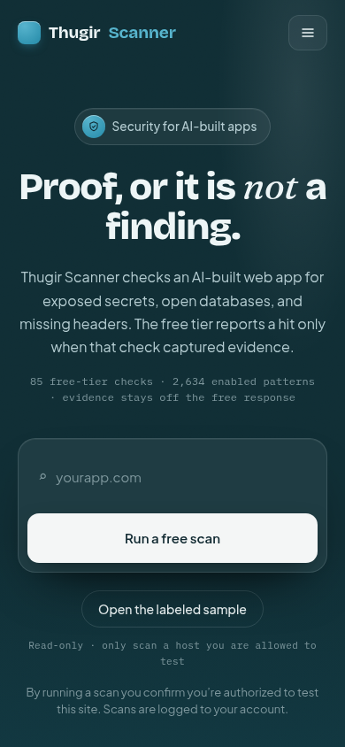
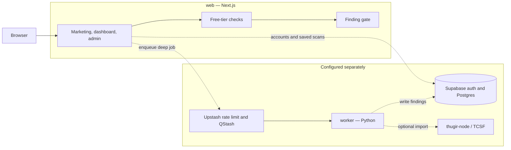

<p align="center">
  
</p>

<p align="center">
  <a href="LICENSE"></a>
  <a href=".github/workflows/ci.yml"></a>
  
  
</p>

**Thugir Scanner finds the misconfigurations AI coding tools leave in a live web app, and it reports a finding only when the check captured proof.**

Maintained by [Ryan Editraj](https://github.com/ryaneditraj). One flagship repository: the scanner you can run. The marketing site and the optional Deep Scan engine stay separate and are linked below.

Launch lines, the hooks that are safe to say, and a twenty-second storyboard are in [docs/LAUNCH.md](docs/LAUNCH.md). The in-app sample is `/demo`: an invented page, real detectors, no network.

## What it actually does

The free tier runs inside this repo. It fetches a page and a capped set of same-origin scripts, fingerprints the stack, and applies checks that require a positive signal: a secret pattern in the bundle, a real `.env` or `.git` response, an open database read, a missing security header, a public source map. Deep-tier checks are counted and titled for a free response. Their evidence and fix text are omitted on the server, not hidden in CSS.

| | |
|---|---|
| **Free starter scan** | TypeScript engine in `web/lib/checks`. No worker, no database, no account when `DEV_MODE=1`. |
| **Evidence gate** | `web/lib/findings/gate.ts` drops gated fields before the JSON response is built. |
| **Pattern library** | 2,639 code-defined patterns in this tree. 2,634 are enabled. 85 of those run on the free tier. New checks can also be rows in Supabase. |
| **SSRF guard** | Private, loopback, link-local, and metadata targets are refused, including obfuscated IP forms and redirects. |
| **Deep Scan worker** | Python service in `worker/`. It runs only with a signed job, and it refuses private targets. The TCSF engine it imports is **not** in this repo. |
| **Accounts and billing** | Supabase auth, Razorpay webhook signatures, ownership checks (file, meta tag, DNS TXT, well-known). Optional for local development. |

This is not a claim about CVEs found, customers, or a hosted service. A hosted deployment is wiring (Vercel, Supabase, a worker host). The code for that wiring is here. The service is not operated by this repository.

## Screenshots

These are captures from this tree, not mockups.

<p>
  
</p>

<p>
  
</p>

<p>
  
</p>

<p>
  
</p>

`/demo` and `npm run demo` run the same detectors on that fixture. A shortened run from this tree:

```text
detected platform: lovable
signals: lovable, supabase
[CRITICAL] Supabase service_role JWT exposed in client bundle
    evidence: {"secretName":"Supabase service_role JWT","sampleRedacted":"eyJhbG...-key"}
[MEDIUM] Critical security headers missing
    evidence: Content-Security-Policy, X-Frame-Options, Strict-Transport-Security, X-Content-Type-Options, Referrer-Policy
A deep-tier copy of the first finding, shown to a free caller, includes evidence? false
```

## Architecture



`DEV_MODE=1` stops at the free-tier box. Supabase, Upstash, Razorpay, and `thugir-node` are not required to read a result.

## Quick start

Node.js 20 or newer. Python 3.11 or newer only if you want the worker tests.

```bash
git clone https://github.com/ryaneditraj/thugir-scanner.git
cd thugir-scanner
npm install --prefix web
cp web/.env.example web/.env.local
```

In `web/.env.local`:

```bash
DEV_MODE=1
DEV_TIER=free
NEXT_PUBLIC_SITE_URL=http://localhost:3000
```

```bash
npm test
npm run demo
npm run dev
```

Open `http://localhost:3000`. Scan a URL you are allowed to test.

From the command line, against one authorized URL:

```bash
npm run scan -- https://example.com
```

`npm test` runs `web/scripts/test-framework.mjs`, `web/scripts/test-security.ts`, and the worker unit tests. `npm run typecheck` and `npm run lint` match CI.

## Usage

**Free scan API** (local dev, no session):

```bash
curl -s http://localhost:3000/api/scan/free \
  -H 'content-type: application/json' \
  -d '{"url":"https://example.com","attest":true}'
```

The handler returns 401 without `DEV_MODE` or a signed-in Supabase user. It returns 400 for private hosts and for targets on the built-in third-party denylist (Google, GitHub, and the other apexes in `web/lib/checks/http.ts`).

**Pattern inventory:**

```bash
npm --prefix web run patterns
```

**Deep Scan worker.** Point `THUGIR_ENGINE_ROOT` at a `thugir-node` tree that contains `tcsf/`, or run `./scripts/sync-engine.sh` when that git remote is reachable. See [worker/README.md](worker/README.md). Unsigned jobs are rejected unless `ALLOW_UNSIGNED_JOBS=1`.

**Full product.** Apply `supabase/migrations` in order, set the variables in [docs/internal/environment-variables.md](docs/internal/environment-variables.md), and deploy `web/` to Vercel with the root directory set to `web/`. Production ignores `DEV_MODE`. Production free scans fail closed if Upstash Redis is unset.

## Repository map

```
thugir-scanner/
├── web/                  Next.js app and the free-tier engine
├── worker/               Deep Scan worker and target guard
├── supabase/             SQL migrations and an optional pattern seed
├── services/thugir-agent/  Vendored VulnClaw (MIT, copyright UncleC)
├── scripts/sync-engine.sh  Optional checkout of thugir-node
└── docs/                 Internal notes and the screenshots in this README
```

Longer internal notes live in [everything.md](everything.md) and [docs/internal/architecture.md](docs/internal/architecture.md). Those notes describe the intended product. Where they disagree with the code, the code wins.

## Where the other Thugir projects fit

This repository is the flagship because it is the thing you can clone and run. Splitting the free-tier engine, the worker, and the migrations into more repos would make the quick start worse.

| Place | Role |
|---|---|
| **This repo** | Scanner, UI, worker, migrations. |
| [thugirlabs.com](https://www.thugirlabs.com) | Public site for the broader research engine. Benchmark figures on that site are not reproduced here. |
| `github.com/ryaneditraj/thugirlabs.com`, `THUGIR-LABS`, `thugirlabs.com-OG` | Not reachable on GitHub when this README was written (HTTP 404). TODO(Ryan): link them when they are public. |
| `services/thugir-agent` | Optional [VulnClaw](https://unclecheng-li.github.io/vulnclaw.com/) agent. Third-party MIT code. |

## Roadmap

Already in this tree:

- Free-tier checks with a server-side blur gate
- Stack fingerprints and fix prompts on patterns
- Ownership verification and Razorpay signature checks
- Monitor records, a cron tick, and delta email when the backends are configured
- An admin console for patterns, keys, and scan control

Still open, and not claimed as done:

- Vendor or publish `thugir-node` so Deep Scan runs without a private checkout
- Next.js 16 upgrade. The current 14.2.35 line has published advisories whose fix is 16.4.5. See [SECURITY.md](SECURITY.md)
- A public verification-badge pass. `/verify` exists; the internal roadmap still lists a quality pass
- One-click scan links, and a way for an analyst to disable a noisy pattern without a deploy
- TODO(Ryan): pricing, uptime, and any customer reference, once those are true

## FAQ

**What is Thugir Scanner?**
Thugir Scanner is an open-source security scanner for AI-built web apps. The free tier in this repository fetches a live URL, looks for high-confidence misconfigurations such as exposed secrets and open databases, and returns a finding only when that check captured evidence.

**Does a free scan need an account?**
On a deployed server, yes. `POST /api/scan/free` requires a Supabase session so the request can be rate-limited and attributed. For local development, `DEV_MODE=1` skips that session. `DEV_MODE` does nothing when `NODE_ENV=production`.

**How is a finding different from an alert?**
The free-tier rules are written to fire on a positive signal: a matched secret, a response body, a header, a row returned to an unauthenticated request. The server then removes evidence and remediation from any finding the caller's tier is not allowed to see.

**Is the deep engine included?**
No. `worker/` can import TCSF from a separate `thugir-node` tree. That tree is not in this repository. The free tier does not need it.

**Is it safe to point at production?**
The free scan is a read-only pass plus a small set of fixed-path probes, and it refuses private and metadata addresses. Only scan a host you own or are authorized to test. Active Deep Scan probing is meant to run after domain ownership is verified.

**Who maintains it?**
Ryan Editraj, GitHub [ryaneditraj](https://github.com/ryaneditraj).

## Contributing

See [CONTRIBUTING.md](CONTRIBUTING.md), [CODE_OF_CONDUCT.md](CODE_OF_CONDUCT.md), and [SECURITY.md](SECURITY.md).

## License

[MIT](LICENSE) for the scanner. `services/thugir-agent` keeps its own MIT license, copyright UncleC. See [NOTICE](NOTICE).

If you use this in research, see [CITATION.cff](CITATION.cff).
