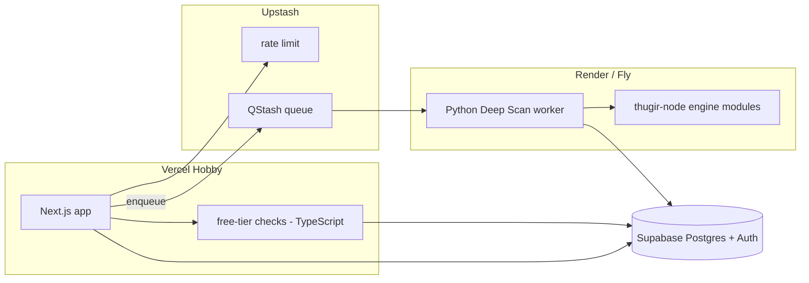

# Architecture: `app/` and how it reuses `thugir-node/`

`app/` (at the repo root) is a separate, commercial, multi-tenant scanner for AI-built
("vibe-coded") apps. It is intentionally decoupled from the autonomous research platform in
`thugir-node/`, which it reuses only as a Deep Scan engine via the worker.

## Two deployables, three planes

- **web/** (Next.js, Vercel): marketing/SEO, auth, dashboard, admin, all API routes, and the
  entire **free-tier** scan engine (single-request checks in TypeScript).
- **worker/** (Python, Render/Fly): the **Deep Scan** executor. The only component that imports
  `thugir-node` and the only one that needs `nmap`/`nikto`/`nuclei`.
- **supabase/**: Postgres (data + pattern library), Auth, RLS.

The two deployables never share a process. They communicate through Supabase (data) and QStash
(jobs).

## Item 1 reuse report - what we reuse from `thugir-node/` (read from code)

The free-tier AI-builder checks (Supabase RLS, Firebase rules, secret patterns, .env/.git/maps,
headers, webhook signature) **do not exist in `thugir-node/`** - they are net-new IP in
[web/lib/patterns](../../web/lib/patterns) and [web/lib/checks](../../web/lib/checks). Engine reuse
is concentrated in **Deep Scan**:

Standalone-callable (URL in / dict out, no kernel, no DB):
- `modules/deep_vuln_scan.py::deep_vuln_scan(target, run_external_tools=, run_nuclei=, timeout=)`
- `modules/url_scanner.py::scan_url(url, run_external_tools=False)`
- `modules/api_reachability.py::scan_api(APIScanConfig(base_url=...))` -> `modules/api/scanner.py::scan_api_security` (OWASP API Top 10: BOLA/IDOR, JWT alg-none, method tampering)
- `adapters/web_vulnerability_adapter.py::WebVulnerabilityAdapter.scan_endpoint(host, port)`

Reused for normalization so Deep Scan findings inherit the trust model:
- `nexus/finding_quality.py::finalize_findings(findings, customer_id=)` - enrich -> demote_unproven_possible -> evidence gate -> FP suppression -> AntiHallucinationGuard
- `nexus/validators/evidence_gate.py`, `nexus/validators/anti_hallucination_guard.py`
- `nexus/scoring/nexus_score.py::NexusScorer` (optional)

Loosely coupled (needs a synthetic `TaskNode` + context dict; best-effort, guarded in the runner):
- `nexus/specialists/injection_specialist.py::InjectionSpecialist.run(node, context)` (SQLi/XSS/SSRF/traversal)

Deliberately NOT reused as a product surface (too heavy for the vibe-app ICP):
- Full Flask TCSF Mission Control (`dashboard/server.py`), campaigns, Neo4j export,
  distributed Pi workers, multi-day hibernation.

**Is reused for Deep Scan** (commercial SLA caps — see [worker/README.md](../../worker/README.md)):
- `tcsf/power/max_power_run.py::run_max_power_investigation` (aggressive mode, precision gate ON)
- `tcsf/runtime::TcsfRuntime` when present (portable embed API from thugirlabs.com)
- `tcsf/evidence/verdict.py::assign_verdicts` → `engine_status` + proof on findings
- `tcsf/kernel` + Strike / VulnClaw power stages when shipped in the synced engine
- Precision gate: High/Critical without exploit proof are demoted / marked inconclusive

Severity model: proof level = `severity` + `evidence_verdict` / `validation_status` +
`is_exploit_verified_finding()`. Our product maps engine findings onto its own
`tier_required` (free/deep) in [worker/runner.py](../../worker/runner.py) `_classify_tier`.

## Free-tier execution (Vercel)

`POST /api/scan/free` runs `lib/checks/runner.ts::runFreeScan`:
1. Normalize + SSRF-guard the target (refuse private/loopback/metadata hosts).
2. Fetch homepage + up to 12 same-origin scripts (byte-capped).
3. Apply `tier_required='free'` patterns: secret regexes, http_probe paths, and `rule_ref`
   rules (security headers, source maps, Supabase RLS/storage probes, Firebase open-rules read,
   CORS (* + reflect-origin), robots.txt sensitive paths, OpenAPI docs exposure, demo/skip-auth
   flags, service_role-in-client, public-env-prefix leak, inline state secrets, GraphQL
   introspection, directory listing).
4. Detect the AI builder ([lib/detect](../../web/lib/detect)).
5. Return free findings fully + deep-tier patterns as **locked teasers**.

## Deep Scan execution (worker)

See [worker/README.md](../../worker/README.md). Sync the engine with
`./scripts/sync-engine.sh` (pulls `thugir-node` from thugirlabs.com). Then:

QStash → `/run` → `runner.run_deep_scan` (TcsfRuntime or max-power, capped) →
`assign_verdicts` → `finalize_findings` → Supabase. Cooperative cancel via
`scans.status='killed'`.

## The blur mechanic (server-side gate)

The trust boundary is [web/lib/findings/gate.ts](../../web/lib/findings/gate.ts) and the
`findings_visible` SQL view. Gated fields (`evidence_json`, `remediation_json`, `fix_prompt`) are
**never serialized** for locked findings - not hidden via CSS, not present in the DOM. A free user
receives only title + severity + category + one-line impact for above-tier findings.

## Billing & entitlements (Razorpay)

All Razorpay code lives in [web/lib/razorpay/index.ts](../../web/lib/razorpay/index.ts) and three
route handlers. Entitlements are the single source of truth for a user's tier
([web/lib/entitlements/index.ts](../../web/lib/entitlements/index.ts) `resolveUserTier`).

**Two products:**
- **Deep Scan** — a one-time Razorpay **order** (`deep_scan_credit`). Default amount ₹499 (49900
  paise); override with `DEEP_SCAN_AMOUNT_INR`.
- **Continuous Protection** — a Razorpay **subscription** (`continuous_sub`), requires
  `RAZORPAY_CONTINUOUS_PLAN_ID`.

**Flow:**
1. `POST /api/billing/create-order` `{ kind }` — auth'd; creates the order or subscription with
   `notes = { user_id, kind, email }` and returns `{ orderId | subscriptionId, keyId, amount }`.
2. Client ([UpgradePanel.tsx](../../web/components/UpgradePanel.tsx)) loads Razorpay Checkout and
   opens it with the returned id.
3. On success, the Checkout `handler` calls `POST /api/billing/verify` with the payment id,
   signature, and BOTH `orderId` and `subscriptionId` (whichever applies) — this is the fast-path
   grant for good UX while the webhook lags.
4. `POST /api/webhooks/razorpay` is the **authoritative** grant path; it verifies the signature
   against the **raw** body, then grants.

**Signature verification — the two HMAC field orders differ (easy to get wrong):**
- Order / one-time: `HMAC_SHA256(order_id + "|" + payment_id, key_secret)` →
  `verifyPaymentSignature`.
- Subscription: `HMAC_SHA256(payment_id + "|" + subscription_id, key_secret)` (opposite order) →
  `verifySubscriptionSignature`. Getting this reversed makes every subscription checkout fail
  verification.
- Webhook: `HMAC_SHA256(rawBody, RAZORPAY_WEBHOOK_SECRET)` compared with `timingSafeEqual` →
  `verifyWebhookSignature`.

**Idempotency:** every grant is keyed on the Razorpay payment/subscription/event id stored in
`entitlements.razorpay_ref`, backed by a partial unique index
([migration 0004](../../supabase/migrations/0004_razorpay_idempotency.sql)). Both the verify route
and the webhook check `razorpay_ref` before inserting, so replays and verify+webhook double-fires
never double-grant.

**Webhook events handled:** `payment.captured` / `order.paid` → grant; `subscription.charged` →
grant/extend 31 days; `subscription.cancelled` → mark active `continuous_sub` cancelled. Because
order `notes` are **not** copied onto the payment entity, `payment.captured` falls back to fetching
the order (`orders.fetch`) to recover `user_id`/`kind` when the payment payload has no notes.

**Deploy checklist:** set `RAZORPAY_KEY_ID`, `RAZORPAY_KEY_SECRET`, `RAZORPAY_WEBHOOK_SECRET`,
`NEXT_PUBLIC_RAZORPAY_KEY_ID`, and (for subscriptions) `RAZORPAY_CONTINUOUS_PLAN_ID` in Vercel;
point the Razorpay webhook at `https://<site>/api/webhooks/razorpay` with the same
`RAZORPAY_WEBHOOK_SECRET` and subscribe to `payment.captured`, `order.paid`,
`subscription.charged`, and `subscription.cancelled`.
